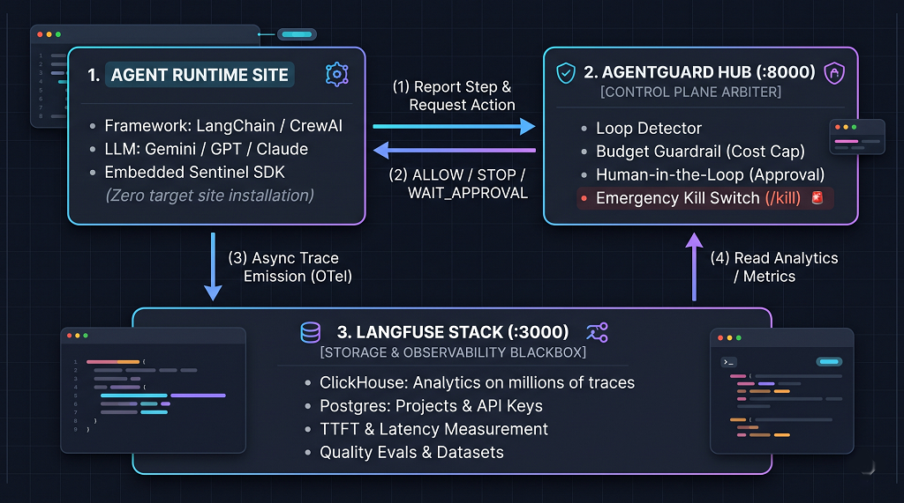

<div align="center">


### *AI Agent Control Plane, Operational Guardrails & Tracing Hub*

[](https://github.com/longnguyen97-full/agent-management-system/actions)
[](https://www.python.org/)
[](https://fastapi.tiangolo.com)
[](https://langfuse.com)
[](https://github.com/astral-sh/uv)
[](LICENSE)

<p align="center">
  <a href="README.md">🇬🇧 English</a> •
  <a href="README.vi.md">🇻🇳 Tiếng Việt</a>
</p>

</div>

---

## 📸 Preview & Screenshots

<div align="center">
  
  <p><em>AgentGuard Control Hub (English UI with USD Currency & Simulation Mode Switcher)</em></p>
</div>

<br/>

<div align="center">
  <table width="100%">
    <tr>
      <td width="50%" align="center">
        
        <br/>
        <strong>🛡️ Human-in-the-Loop Authorization</strong>
        <br/>
        <em>Pauses agent before executing sensitive database updates until authorized.</em>
      </td>
      <td width="50%" align="center">
        
        <br/>
        <strong>🛑 Infinite Loop Guardrail</strong>
        <br/>
        <em>Catches repetitive reasoning/tool calls and aborts before wasting API tokens.</em>
      </td>
    </tr>
    <tr>
      <td width="50%" align="center">
        
        <br/>
        <strong>⚡ Live Mode & Langfuse ClickHouse Telemetry</strong>
        <br/>
        <em>Real production traces, span counts, and token analytics synced live from ClickHouse.</em>
      </td>
      <td width="50%" align="center">
        
        <br/>
        <strong>🌐 Dual Language & Currency Switcher</strong>
        <br/>
        <em>One-click toggle between English ($ USD) and Vietnamese (₫ VND) with live exchange rates.</em>
      </td>
    </tr>
  </table>
</div>

---

## 💡 Overview & Core Capabilities

**AgentGuard** is an open-source **Control Plane and Operational Safety Layer** designed for running Autonomous AI Agents safely in production environments:

- **🚨 Emergency Kill Switch**: Instantly terminates any running agent process directly from the Web Dashboard or REST API.
- **🔄 Infinite Loop Guardrail**: Automatically monitors tool call signatures and aborts rogue agents when repetitive behavior is detected.
- **💰 Hard Budget Guardrail**: Enforces strict ceilings on total token consumption and estimated spend per session.
- **👤 Human-in-the-Loop (HITL) Approval**: Automatically pauses execution when an agent attempts sensitive actions (e.g. database updates, financial transactions, external communications) and awaits human approval.
- **🧪 Simulation Mode Toggle**: 1-click switch between **Simulation Sandbox** (mock execution for instant zero-cost guardrail testing) and **Live Production Mode**.
- **⚡ Billable vs. Non-Billable Separation**: Accurately isolates LLM inference costs from free local operations (deterministic python code, database queries, cached tools).
- **🧮 ROI & Token Cost Estimator**: Interactive calculator modeling token costs, session volumes, and cost savings achieved by Guardrails (Loop and Budget caps).
- **🔄 Dynamic LLM Pricing Sync**: Backed by verified official pricing (OpenAI, DeepMind, Anthropic, DeepSeek, Local/vLLM) with 1-click online synchronization from the LiteLLM open-source pricing index.
- **🌐 Dual-Language UI & Automatic Currency Sync**: Built-in support for English (default, with USD `$`) and Vietnamese (with VND `₫`).
- **💾 Zero-Dependency SQLite Persistence**: Automatically stores session history and step logs to `data/agentguard.db`, surviving server restarts.
- **🔔 Multi-Channel Webhook Alerts**: In-dashboard configuration modal with 1-click test button for Discord (Rich Embeds), Slack, and generic webhooks (n8n/Telegram).
- **📊 Audit Exporter (CSV & JSON)**: Export single-run audit logs with full billable breakdown, or download full-history CSV reports (`/api/agents/export/all`).
- **⏮️ Time-Travel Step Replay**: Replay the agent's thought trajectory step-by-step with adjustable speed (0.5x, 1x, 2x) and smooth auto-scrolling highlight.
- **🌐 OpenTelemetry (OTLP) Ingestion**: Standard `POST /v1/traces` endpoint for ingesting spans directly from CrewAI, LangGraph, and AutoGen.
- **🔤 Automatic Text Sanitizer (`ftfy`)**: Auto-repairs corrupted mojibake and encoding mismatches for international and Vietnamese characters.
- **📖 Interactive User Guide (`/guide`)**: Dedicated, comprehensive documentation accessible directly from the top menu.
- **🔍 Deep Tracing Stack**: Pre-configured, self-hosted Langfuse cluster (Web UI, ClickHouse, PostgreSQL, Redis, MinIO) via Docker Compose.
- **🔌 Zero-Friction Client SDK (`agent_sdk.py`)**: Seamlessly connects external agents (LangChain, CrewAI, AutoGen, or vanilla scripts) into the central monitoring hub.
- **📦 Data Lifecycle & Disaster Recovery (Backup / Restore / Reset)**: Automated 1-click backup of Dashboard SQLite databases and Langfuse PostgreSQL/ClickHouse traces into compressed `.zip` archives. Features automated pre-restore and pre-reset rollback protection, live Web UI management modal, and dedicated CLI (`scripts/backup_manager.py`).

---

## 🏛️ System Architecture & Working Principle

<div align="center">
  
</div>

### 🔑 The 3-Tier Operational Principle:
1. **Host Site / Agent Runtime (with Sentinel SDK)**:
   - Your agent application (Next.js, FastAPI, LangChain, CrewAI) embeds the lightweight Sentinel SDK (`agent_sdk.py` or `agentHubClient.ts`).
   - **Target websites (Shopee, Vietcombank, etc.) do NOT install anything.** The SDK is embedded in the *Agent*, notifying the Hub before reasoning steps or sensitive tool executions.
2. **AgentGuard Control Hub (:8000)**:
   - Serves as the real-time **Umpire & Control Plane**.
   - Evaluates active Guardrails (*Loop Detector*, *Budget Limiter*, *Human-in-the-Loop Approval*, *Kill Switch*).
   - Issues immediate decisions: `ALLOW`, `PAUSE (Waiting Approval)`, or `TERMINATE (Kill)`.
3. **Langfuse Deep Tracing Stack (:3000)**:
   - Operates as the **Flight Data Recorder**.
   - Asynchronously ingests high-volume OTel traces, token telemetry, and latencies into ClickHouse & PostgreSQL for deep debugging and evals.

---

## ⚡ Quick Start

### 1. Requirements
- Python >= 3.11
- [uv](https://docs.astral.sh/uv/) (recommended for fast package management)
- Docker & Docker Compose

### 2. Start Langfuse Observability Stack
Launch the self-hosted tracing cluster:
```bash
docker compose up -d
```
> The Langfuse Web UI will be available at: **[http://localhost:3000](http://localhost:3000)**  
> *Default credentials:* `admin@example.com` / `AdminPassword123!`

### 3. Start Control Plane Backend & Dashboard
```bash
# Sync dependencies
uv sync --all-groups

# Launch AgentGuard
uv run run.py
# or using the CLI shortcut:
uv run agent-hub
```

Now open:
- 📊 **AgentGuard Dashboard:** [http://localhost:8000/dashboard](http://localhost:8000/dashboard)
- 📖 **Interactive User Guide:** [http://localhost:8000/guide](http://localhost:8000/guide)
- 📖 **API Docs (Swagger):** [http://localhost:8000/docs](http://localhost:8000/docs)
- 🔍 **Health Check:** [http://localhost:8000/health](http://localhost:8000/health)

---

## 🧪 Interactive Demo Scenarios

Open the Web Dashboard at `http://localhost:8000/dashboard` to test preset scenarios with 1 click:

| Scenario | Action | Outcome Observed |
| :--- | :--- | :--- |
| **1. Standard 3-Step Task** | Multi-step reasoning + tool execution. | Real-time token count, USD/VND cost breakdown, step timeline. |
| **2. Human-in-the-Loop** | Agent attempts sensitive tool `execute_database_update`. | Agent automatically pauses in `WAITING_APPROVAL`. Operator clicks **Authorize** or **Reject** in real time. |
| **3. Loop Detector** | Agent makes repeated calls with identical arguments. | Guardrail triggers on 2nd repeat; run is safely aborted before wasting tokens. |
| **4. Kill Switch** | Operator triggers red Emergency Stop button. | Run status changes immediately to `KILLED` and execution thread terminates. |

---

## 🔌 Integrating Any External Agent (Live Agent Sessions)

AgentGuard allows connecting **any external system** (Python, Node.js, Next.js, Go) into its live Control Plane via 1-click AI Agent Skill, Python SDK (`agent_sdk.py`), or TypeScript helper client.

### 🤖 Option 0: 1-Click Automated AI Assistant Integration (Recommended)

Don't want to write or edit code manually? If you use an AI coding assistant (**Google Antigravity**, **Cursor**, **Claude Code**, **GitHub Copilot**, or **Windsurf**), you can embed AgentGuard into any AI bot with a single prompt using our official **AI Assistant Skill** ([`skills/embed-agentguard/SKILL.md`](skills/embed-agentguard/SKILL.md)):

```markdown
"Use embed-agentguard skill to wrap this AI agent with AgentGuard guardrails and telemetry at http://localhost:8000"
```

The coding assistant will automatically:
1. Scan your project structure (Python, TypeScript, or Next.js; LangChain, CrewAI, AutoGen, LlamaIndex, or custom loop).
2. Copy the appropriate Sentinel SDK (`agent_sdk.py` or `agentHubClient.ts`).
3. Add `AGENT_HUB_URL=http://localhost:8000` to `.env`.
4. Wrap existing LLM calls with `start_run()`, `log_step()`, and `finish()` with fail-open safety (ensuring your agent never crashes if the Hub is offline).
5. Mark deterministic tools ($0.00 / 0 tokens) vs billable LLM reasoning calls.
6. Verify `/health` connectivity and provide a direct link to your live Dashboard.

---

### 🐍 Option A: Python Agent (using `agent_sdk.py`)

```python
from agent_sdk import AgentTracker

# 1. Initialize tracker pointing to your hub
tracker = AgentTracker(endpoint="http://localhost:8000")

# 2. Register new run session
session = tracker.start_run(
    agent_name="OrderSupportAgent",
    prompt="Check status for order #DH-9921 and issue discount coupon",
    budget_usd=0.25
)

# 3. Log billable LLM thought / action
session.log_step(
    thought="Analyzing customer request and querying order database.",
    tool_name="order_database_query",
    tool_input={"order_id": "DH-9921"},
    tool_output={"status": "DELIVERED"},
    tokens_used=240,
    cost_usd=0.00008,
    is_billable=True
)

# 4. Log non-billable local computation (0 VND / $0.00)
session.log_step(
    thought="Generating promotional coupon code locally.",
    tool_name="generate_promo_coupon",
    tool_input={"discount_percent": 10},
    tool_output={"code": "SAVE10"},
    tokens_used=0,
    cost_usd=0.0,
    is_billable=False
)

# 5. Conclude session
session.finish(final_output="Order delivered! Coupon SAVE10 generated.")
```

> Run live multi-system integration test across 3 satellite agents:
> ```bash
> uv run python mock-systems/run_all.py --test
> ```

### 🌐 Option B: TypeScript / Next.js / Node.js Agent

For web backends and Next.js applications, send lifecycle HTTP calls directly:

```typescript
// 1. Register new session
const res = await fetch('http://localhost:8000/api/agents/external/start', {
  method: 'POST',
  headers: { 'Content-Type': 'application/json' },
  body: JSON.stringify({
    agent_name: 'Content_Review_Agent',
    prompt: 'Check ad policy compliance',
    max_steps: 3,
    budget_usd: 0.20
  })
});
const { run_id } = await res.json();

// 2. Stream steps to Hub (live SSE on dashboard)
await fetch(`http://localhost:8000/api/agents/external/${run_id}/step`, {
  method: 'POST',
  headers: { 'Content-Type': 'application/json' },
  body: JSON.stringify({
    step_number: 1,
    thought: 'Deterministic local regex scan',
    tool_name: 'regex_policy_scanner',
    tokens_used: 0,
    cost_usd: 0.0,
    is_billable: false
  })
});

// 3. Mark complete
await fetch(`http://localhost:8000/api/agents/external/${run_id}/finish`, {
  method: 'POST',
  headers: { 'Content-Type': 'application/json' },
  body: JSON.stringify({ status: 'COMPLETED', final_output: 'Approved' })
});
```

> 📖 **Full Integration Guide:** See [docs/CLIENT_INTEGRATION_GUIDE.md](docs/CLIENT_INTEGRATION_GUIDE.md) for full architecture explanation, difference between Langfuse Traces and Live Sessions, and complete checklists.

### ⚠️ Crucial Gotchas & Troubleshooting (Lưu Ý Quan Trọng)

1. **Vietnamese Encoding on Windows (`cp1252` vs `UTF-8`):**
   - If sending Vietnamese text (e.g. `[TIKTOK] Mỹ phẩm trị mụn...`) from a Windows client, characters may turn into `?` or `` if your environment defaults to `cp1252 / ANSI`.
   - **Fix for Python:** Add `import os; os.environ["PYTHONUTF8"] = "1"` at line 1, and always open files with `encoding="utf-8"`.
   - **Fix for HTTP Clients:** Always send header `Content-Type: application/json; charset=utf-8`.
   - **Fix for PowerShell/CMD:** Run `chcp 65001` before executing terminal scripts.
2. **Preventing `ModuleNotFoundError: No module named 'fastapi'`:**
   - Always run with `uv run run.py` (or `uv run agent-hub`) instead of raw `python run.py`.
3. **Accurate Cost Reporting (`is_billable`):**
   - Set `is_billable: true` ONLY when invoking paid LLMs (OpenAI, Gemini, Claude).
   - Set `is_billable: false` and `cost_usd: 0.0` for deterministic local tools, regex scanners, database queries, and cache hits.

---


## 🏢 Live Satellite Mock Systems (`mock-systems/`) & Metrics Guide

AgentGuard includes **3 fully functioning standalone host systems** with embedded Sentinel SDKs that simulate enterprise AI operations across different tech stacks (FastAPI, Node.js, Python Worker):

| Satellite System | Port & Stack | Agent Persona | Tested Guardrails | Expected Behavior |
| :--- | :--- | :--- | :--- | :--- |
| **1. E-Commerce Service** | `:8010` (FastAPI) | `CustomerCareBot`: Order tracking, inventory query, coupon generation | 🟢 **Cost Breakdown** ($0.00 vs Billable) | Separates billable LLM reasoning from $0.00 deterministic tool calls. Status: `COMPLETED`. |
| **2. FinTech Transfer** | `:8020` (Node.js) | `BankTransferAgent`: Autonomous wallet transfer | ⏸️ **Human-in-the-Loop** (`WAITING_APPROVAL`) | Intercepts high-value transaction. Operator approves/rejects live on Dashboard. |
| **3. Autonomous Crawler** | `:8030` (Python Worker) | `MarketCrawlerWorker`: Scraping market reports | 🛡️ **Loop Detector** & 💰 **Budget Limiter** | SHA-256 arg hasher halts run on 2nd repeat. Status: `LOOP_DETECTED`. |

### 🚀 1-Command Orchestration

```bash
# Option A: One-Shot Autonomous Test & Exit (E2E Verification)
uv run python mock-systems/run_all.py --test

# Option B: Persistent Daemon Mode (Keeps :8010, :8020, :8030 alive for cURL/Postman)
uv run python mock-systems/run_all.py --daemon
```

### 📊 Step-by-Step Metric Interpretation

When viewing sessions in **Live Mode** (`http://localhost:8000/dashboard`):

1. **Total Runs (Tổng Số Phiên Chạy)**: Total agent sessions ingested from satellite systems.
2. **Pending Approval (Đang Chờ Phê Duyệt)**: Counts runs paused in `WAITING_APPROVAL` (e.g. from `:8020`). Click **Authorize** to proceed or **Reject** to abort.
3. **Total Tokens (Tổng Token Ghi Nhận)**: Sum of all billable LLM tokens consumed. Note that deterministic steps (e.g., local database lookup) consume `0 tokens`.
4. **Estimated Cost (Ước Tính Chi Phí)**: Live calculated cost in USD or VND (e.g. `240 tokens * $0.00035/1k = ₫2`). Toggle between **VND (₫)** and **USD ($)** at the top bar.
5. **ReAct Trajectory Inspector**: Click any session to replay step-by-step thoughts, inputs, outputs, execution latencies (ms), and cost tags.
6. **Langfuse Deep Traces (:3000)**: Click the **Open Langfuse** button to inspect the full OpenTelemetry waterfall spans, token distributions, and ClickHouse latency histograms.

> 📖 **Comprehensive Documentation**: See [`docs/MOCK_SYSTEMS_GUIDE.md`](docs/MOCK_SYSTEMS_GUIDE.md) and interactive guide at [http://localhost:8000/guide](http://localhost:8000/guide).

## 🧪 Automated Test Suite

Run the full end-to-end and guardrail test suite:

```bash
uv run pytest -v
```

```text
tests/test_agent_system.py::test_standard_agent_execution PASSED         [ 16%]
tests/test_agent_system.py::test_loop_detector_guardrail PASSED          [ 33%]
tests/test_agent_system.py::test_budget_limit_guardrail PASSED           [ 50%]
tests/test_agent_system.py::test_human_in_the_loop_approval PASSED       [ 66%]
tests/test_agent_system.py::test_emergency_kill_switch PASSED            [ 83%]
tests/test_external_api.py::test_external_agent_ingestion_lifecycle PASSED [100%]
============================== 6 passed in 19s ===============================
```

---

## 📂 Repository Structure

```text
agent-management-system/
├── assets/                  # Site logos (SVG, PNG), QR code & UI screenshots
├── docker-compose.yml       # Full Langfuse tracing stack (Web, Worker, ClickHouse, Postgres, Redis, MinIO)
├── .env.example             # Safe environment configuration template
├── pyproject.toml           # Package configuration & dependencies
├── run.py                   # Fast application launcher (UTF-8 safe)
├── Dockerfile               # Container packaging for control backend
├── agent_sdk.py             # Portable zero-dependency client SDK
├── backend/
│   └── app/
│       ├── main.py          # FastAPI application entrypoint & static mounting
│       ├── config.py        # Pydantic Settings configuration
│       ├── core/
│       │   ├── tracer.py        # Langfuse v5 SDK wrapper (OpenInference / OTel)
│       │   ├── guardrails.py    # Guardrails: Loop detection, Budget limits, Approval checks
│       │   ├── registry.py      # Agent lifecycle state registry & SSE streaming
│       │   ├── alerts.py        # Multi-channel webhooks (Discord, Slack, n8n)
│       │   ├── auth.py          # Operator API Key verification
│       │   ├── db.py            # SQLite session & step persistence
│       │   ├── export.py        # Audit export utilities (CSV / JSON)
│       │   ├── otlp.py          # OpenTelemetry OTLP standard trace ingestion
│       │   ├── pricing.py       # Dynamic LLM Pricing & token economics sync
│       │   └── sanitizer.py     # Vietnamese & unicode mojibake auto-repair
│       ├── agents/
│       │   ├── base.py          # Abstract BaseAgent lifecycle definition
│       │   └── sample_agent.py  # ReAct agent implementation
│       ├── api/
│       │   └── routes.py        # REST API endpoints & SSE broadcast
│       ├── schemas/
│       │   └── agent.py         # Pydantic domain schemas
│       └── templates/
│           ├── dashboard.html   # Real-time dark-themed monitoring & control UI
│           └── guide.html       # Interactive User Guide & Manual
├── scripts/
│   ├── generate_screenshots.py # Playwright automated UI screenshot generator (EN/VI)
│   └── backup_manager.py       # Data Lifecycle CLI for Backup, Restore & Purge
├── docs/
│   └── CLIENT_INTEGRATION_GUIDE.md # SDK & API integration guide
└── tests/                       # Comprehensive test suite (20 unit & integration tests)
```

---

## 💬 Community & Feedback

We welcome your feedback, questions, and ideas:
- **⭐ Star on GitHub**: If you like AgentGuard, please consider giving it a star on [GitHub](https://github.com/longnguyen97-full/agent-management-system/) to help others discover it!
- **GitHub Discussions / Issues**: Report bugs or propose new guardrails via [GitHub Issues](https://github.com/longnguyen97-full/agent-management-system/issues).

---

## 💖 Support & Donate

If you find **AgentGuard** useful and want to support its ongoing open-source development, consider buying the author a coffee! ☕

<div align="center">
  
  <br/>
  <em>Scan via Mobile Banking / VietQR to support this project</em>
  <br/>
  <strong>Thank you for empowering open-source AI safety! ❤️</strong>
</div>

---

## 🤝 Contributing

Contributions are very welcome! Please see [CONTRIBUTING.md](CONTRIBUTING.md) for local development instructions and [CODE_OF_CONDUCT.md](CODE_OF_CONDUCT.md) for community guidelines.

---

## 📄 License

This project is licensed under the [MIT License](LICENSE) — free for personal, educational, and commercial use.
