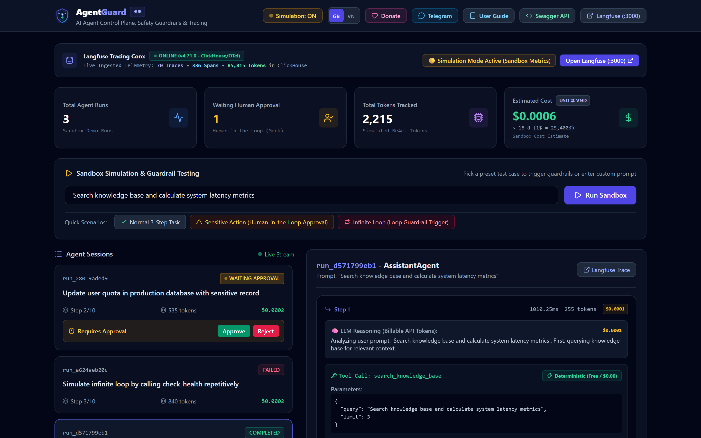
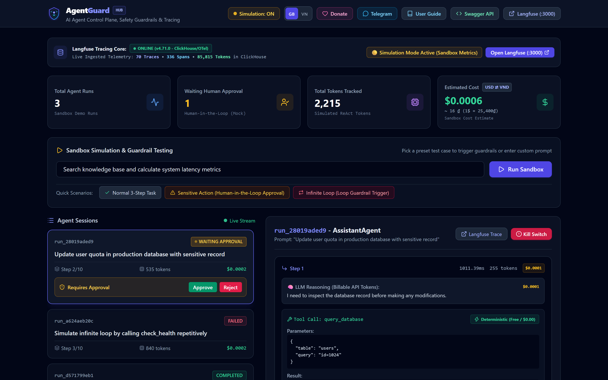
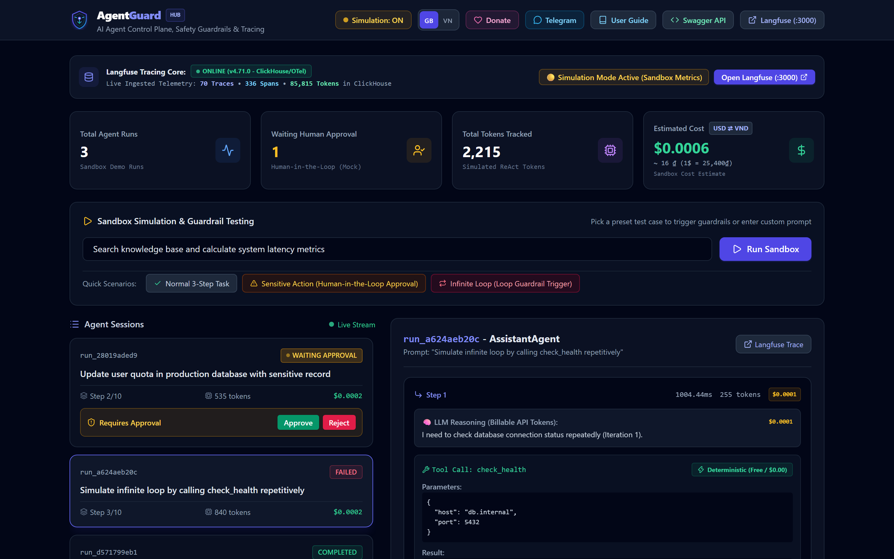
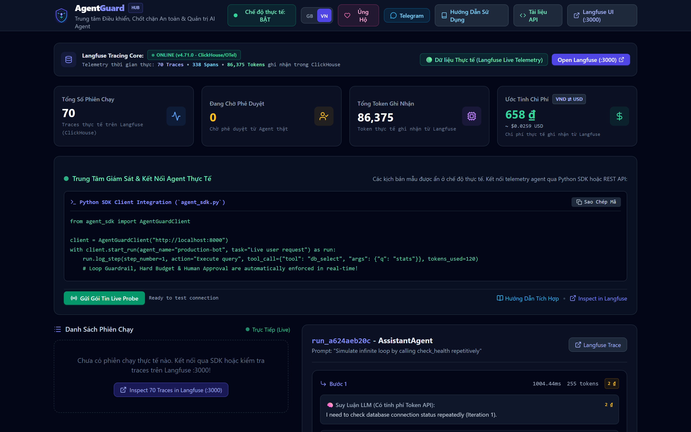
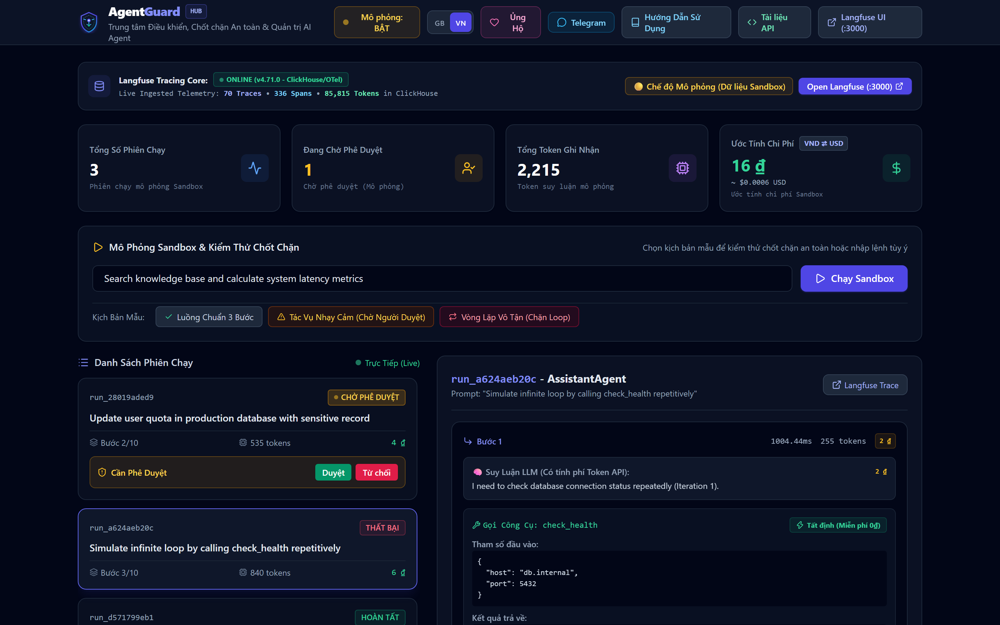

<div align="center">


### *AI Agent Control Plane, Operational Guardrails & Tracing Hub*

[](https://github.com/longnguyen97-full/agent-management-system/actions)
[](https://www.python.org/)
[](https://fastapi.tiangolo.com)
[](https://langfuse.com)
[](https://github.com/astral-sh/uv)
[](LICENSE)

<p align="center">
  <a href="README.md">🇬🇧 English</a> •
  <a href="README.vi.md">🇻🇳 Tiếng Việt</a>
</p>

</div>

---

## 📸 Preview & Screenshots

<div align="center">
  
  <p><em>AgentGuard Control Hub (English UI with USD Currency & Simulation Mode Switcher)</em></p>
</div>

<br/>

<div align="center">
  <table width="100%">
    <tr>
      <td width="50%" align="center">
        
        <br/>
        <strong>🛡️ Human-in-the-Loop Authorization</strong>
        <br/>
        <em>Pauses agent before executing sensitive database updates until authorized.</em>
      </td>
      <td width="50%" align="center">
        
        <br/>
        <strong>🛑 Infinite Loop Guardrail</strong>
        <br/>
        <em>Catches repetitive reasoning/tool calls and aborts before wasting API tokens.</em>
      </td>
    </tr>
    <tr>
      <td width="50%" align="center">
        
        <br/>
        <strong>⚡ Live Mode & Langfuse ClickHouse Telemetry</strong>
        <br/>
        <em>Real production traces, span counts, and token analytics synced live from ClickHouse.</em>
      </td>
      <td width="50%" align="center">
        
        <br/>
        <strong>🌐 Dual Language & Currency Switcher</strong>
        <br/>
        <em>One-click toggle between English ($ USD) and Vietnamese (₫ VND) with live exchange rates.</em>
      </td>
    </tr>
  </table>
</div>

---

## 💡 Overview & Core Capabilities

**AgentGuard** is an open-source **Control Plane and Operational Safety Layer** designed for running Autonomous AI Agents safely in production environments:

- **🚨 Emergency Kill Switch**: Instantly terminates any running agent process directly from the Web Dashboard or REST API.
- **🔄 Infinite Loop Guardrail**: Automatically monitors tool call signatures and aborts rogue agents when repetitive behavior is detected.
- **💰 Hard Budget Guardrail**: Enforces strict ceilings on total token consumption and estimated spend per session.
- **👤 Human-in-the-Loop (HITL) Approval**: Automatically pauses execution when an agent attempts sensitive actions (e.g. database updates, financial transactions, external communications) and awaits human approval.
- **🧪 Simulation Mode Toggle**: 1-click switch between **Simulation Sandbox** (mock execution for instant zero-cost guardrail testing) and **Live Production Mode**.
- **⚡ Billable vs. Non-Billable Separation**: Accurately isolates LLM inference costs from free local operations (deterministic python code, database queries, cached tools).
- **🌐 Dual-Language UI & Automatic Currency Sync**: Built-in support for English (default, with USD `$`) and Vietnamese (with VND `₫`).
- **📖 Interactive User Guide (`/guide`)**: Dedicated, comprehensive documentation accessible directly from the top menu.
- **🔍 Deep Tracing Stack**: Pre-configured, self-hosted Langfuse cluster (Web UI, ClickHouse, PostgreSQL, Redis, MinIO) via Docker Compose.
- **🔌 Zero-Friction Client SDK (`agent_sdk.py`)**: Seamlessly connects external agents (LangChain, CrewAI, AutoGen, or vanilla scripts) into the central monitoring hub.

---

## 🏛️ System Architecture

```
                                 ┌──────────────────────────────────────────────┐
                                 │     AgentGuard Operator Dashboard Web UI     │
                                 │         http://localhost:8000/dashboard      │
                                 └──────────────┬───────────────────────────────┘
                                                │
                                    (SSE & REST API Call)
                                                ▼
  ┌─────────────────────────────────────────────────────────────────────────────┐
  │                 AgentGuard FastAPI Service (Control Plane)                  │
  │                                                                             │
  │  ┌───────────────────────┐   ┌──────────────────────┐   ┌─────────────────┐ │
  │  │ Loop Guardrail        │   │ Budget Guardrail     │   │ Human-in-the-   │ │
  │  │ (Prevents Runaway)    │   │ (Caps Token & Cost)  │   │ Loop Approval   │ │
  │  └───────────────────────┘   └──────────────────────┘   └─────────────────┘ │
  │                                                                             │
  │  ┌───────────────────────┐   ┌──────────────────────┐   ┌─────────────────┐ │
  │  │ Emergency Kill Switch │   │ Agent Run Registry   │   │ OpenInference   │ │
  │  │ (Instant Termination) │   │ (In-memory State)    │   │ Telemetry Span  │ │
  │  └───────────────────────┘   └──────────────────────┘   └────────┬────────┘ │
  └──────────────────────────────────────────────────────────────────┼──────────┘
                                                                     │
                                                   (OTel / Langfuse Ingestion)
                                                                     ▼
  ┌─────────────────────────────────────────────────────────────────────────────┐
  │                  Langfuse Tracing Stack (Docker Compose)                    │
  │                                                                             │
  │   - Langfuse Web UI (:3000)      - Langfuse Worker (:3030)                  │
  │   - PostgreSQL 17 (DB)           - ClickHouse (High-throughput analytics)   │
  │   - Redis (BullMQ queue)         - MinIO (Blob storage)                     │
  └─────────────────────────────────────────────────────────────────────────────┘
```

---

## ⚡ Quick Start

### 1. Requirements
- Python >= 3.11
- [uv](https://docs.astral.sh/uv/) (recommended for fast package management)
- Docker & Docker Compose

### 2. Start Langfuse Observability Stack
Launch the self-hosted tracing cluster:
```bash
docker compose up -d
```
> The Langfuse Web UI will be available at: **[http://localhost:3000](http://localhost:3000)**  
> *Default credentials:* `admin@example.com` / `AdminPassword123!`

### 3. Start Control Plane Backend & Dashboard
```bash
# Sync dependencies
uv sync --all-groups

# Launch AgentGuard
uv run run.py
# or using the CLI shortcut:
uv run agent-hub
```

Now open:
- 📊 **AgentGuard Dashboard:** [http://localhost:8000/dashboard](http://localhost:8000/dashboard)
- 📖 **Interactive User Guide:** [http://localhost:8000/guide](http://localhost:8000/guide)
- 📖 **API Docs (Swagger):** [http://localhost:8000/docs](http://localhost:8000/docs)
- 🔍 **Health Check:** [http://localhost:8000/health](http://localhost:8000/health)

---

## 🧪 Interactive Demo Scenarios

Open the Web Dashboard at `http://localhost:8000/dashboard` to test preset scenarios with 1 click:

| Scenario | Action | Outcome Observed |
| :--- | :--- | :--- |
| **1. Standard 3-Step Task** | Multi-step reasoning + tool execution. | Real-time token count, USD/VND cost breakdown, step timeline. |
| **2. Human-in-the-Loop** | Agent attempts sensitive tool `execute_database_update`. | Agent automatically pauses in `WAITING_APPROVAL`. Operator clicks **Authorize** or **Reject** in real time. |
| **3. Loop Detector** | Agent makes repeated calls with identical arguments. | Guardrail triggers on 2nd repeat; run is safely aborted before wasting tokens. |
| **4. Kill Switch** | Operator triggers red Emergency Stop button. | Run status changes immediately to `KILLED` and execution thread terminates. |

---

## 🔌 Integrating Any External Agent (Lightweight SDK)

You can connect **any existing agent** (written in LangChain, CrewAI, AutoGen, or vanilla Python) into this Control Hub using `agent_sdk.py`:

```python
from agent_sdk import AgentTracker

# 1. Initialize tracker pointing to your hub
tracker = AgentTracker(endpoint="http://localhost:8000")

# 2. Register new run session
session = tracker.start_run(
    agent_name="OrderSupportAgent",
    prompt="Check status for order #DH-9921 and issue discount coupon",
    budget_usd=0.25
)

# 3. Log billable LLM thought / action
session.log_step(
    thought="Analyzing customer request and querying order database.",
    tool_name="order_database_query",
    tool_input={"order_id": "DH-9921"},
    tool_output={"status": "DELIVERED"},
    tokens_used=240,
    cost_usd=0.00008,
    is_billable=True
)

# 4. Log non-billable local computation (0 VND / $0.00)
session.log_step(
    thought="Generating promotional coupon code locally.",
    tool_name="generate_promo_coupon",
    tool_input={"discount_percent": 10},
    tool_output={"code": "SAVE10"},
    tokens_used=0,
    cost_usd=0.0,
    is_billable=False
)

# 5. Conclude session
session.finish(final_output="Order delivered! Coupon SAVE10 generated.")
```

> Try running the included external agent demo:
> ```bash
> uv run python examples/external_agent_demo.py
> ```

---

## 🧪 Automated Test Suite

Run the full end-to-end and guardrail test suite:

```bash
uv run pytest -v
```

```text
tests/test_agent_system.py::test_standard_agent_execution PASSED         [ 16%]
tests/test_agent_system.py::test_loop_detector_guardrail PASSED          [ 33%]
tests/test_agent_system.py::test_budget_limit_guardrail PASSED           [ 50%]
tests/test_agent_system.py::test_human_in_the_loop_approval PASSED       [ 66%]
tests/test_agent_system.py::test_emergency_kill_switch PASSED            [ 83%]
tests/test_external_api.py::test_external_agent_ingestion_lifecycle PASSED [100%]
============================== 6 passed in 19s ===============================
```

---

## 📂 Repository Structure

```text
agent-management-system/
├── assets/                  # Site logos (SVG, PNG), QR code & UI screenshots
├── docker-compose.yml       # Full Langfuse tracing stack (Web, Worker, ClickHouse, Postgres, Redis, MinIO)
├── .env.example             # Safe environment configuration template
├── pyproject.toml           # Package configuration & dependencies
├── run.py                   # Fast application launcher (UTF-8 safe)
├── Dockerfile               # Container packaging for control backend
├── agent_sdk.py             # Portable zero-dependency client SDK
├── backend/
│   └── app/
│       ├── main.py          # FastAPI application entrypoint & static mounting
│       ├── config.py        # Pydantic Settings configuration
│       ├── core/
│       │   ├── tracer.py    # Langfuse v5 SDK wrapper (OpenInference / OTel)
│       │   ├── guardrails.py# Guardrails: Loop detection, Budget limits, Approval checks
│       │   └── registry.py  # Agent lifecycle state registry & SSE streaming
│       ├── agents/
│       │   ├── base.py      # Abstract BaseAgent lifecycle definition
│       │   └── sample_agent.py # ReAct agent implementation
│       ├── api/
│       │   └── routes.py    # REST API endpoints & SSE broadcast
│       ├── schemas/
│       │   └── agent.py     # Pydantic domain schemas
│       └── templates/
│           ├── dashboard.html # Real-time dark-themed monitoring & control UI
│           └── guide.html     # Interactive User Guide & Manual
├── examples/
│   └── external_agent_demo.py # Complete example of an external agent using SDK
├── docs/
│   └── CLIENT_INTEGRATION_GUIDE.md # SDK & API integration guide
└── tests/
    ├── test_agent_system.py  # Core guardrail and agent flow tests
    └── test_external_api.py  # External ingestion lifecycle tests
```

---

## 💬 Community & Feedback

We welcome your feedback, questions, and ideas:
- **Telegram Developer Community**: Join our [Telegram Group](https://t.me/+placeholder_agentguard) with live AI Support Agent for quick technical assistance.
- **GitHub Discussions / Issues**: Report bugs or propose new guardrails via [GitHub Issues](https://github.com/longnguyen97-full/agent-management-system/issues).

---

## 💖 Support & Donate

If you find **AgentGuard** useful and want to support its ongoing open-source development, consider buying the author a coffee! ☕

<div align="center">
  
  <br/>
  <em>Scan via Mobile Banking / VietQR to support this project</em>
  <br/>
  <strong>Thank you for empowering open-source AI safety! ❤️</strong>
</div>

---

## 🤝 Contributing

Contributions are very welcome! Please see [CONTRIBUTING.md](CONTRIBUTING.md) for local development instructions and [CODE_OF_CONDUCT.md](CODE_OF_CONDUCT.md) for community guidelines.

---

## 📄 License

This project is licensed under the [MIT License](LICENSE) — free for personal, educational, and commercial use.
