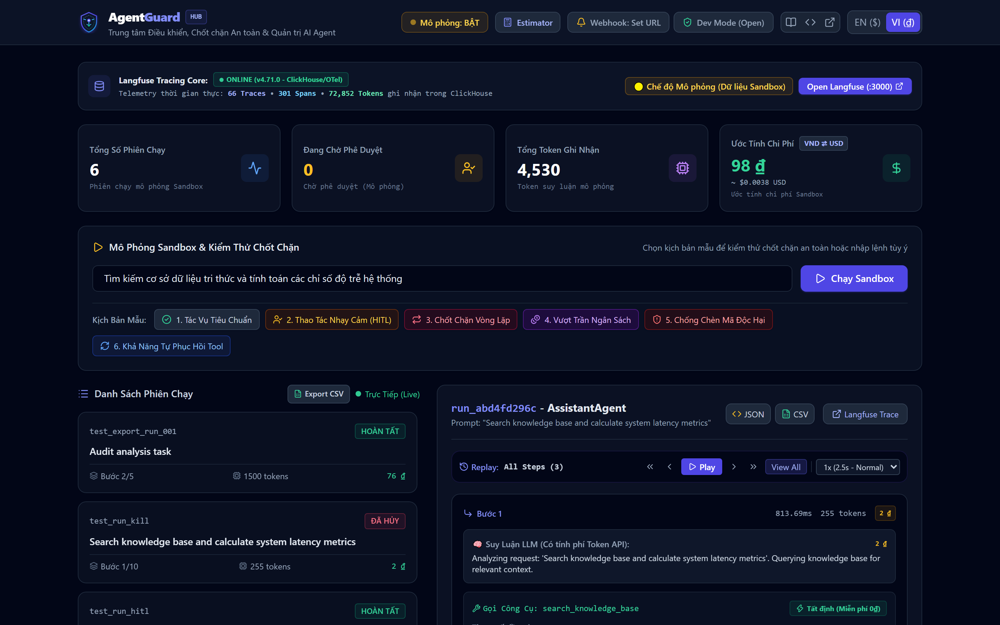
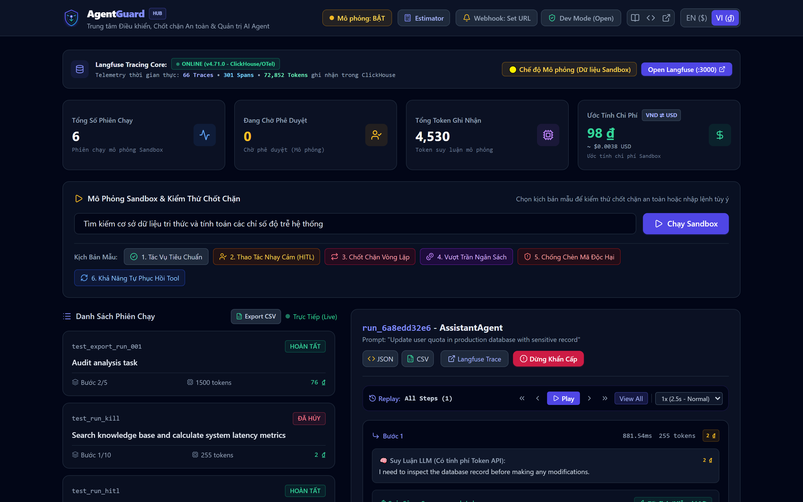
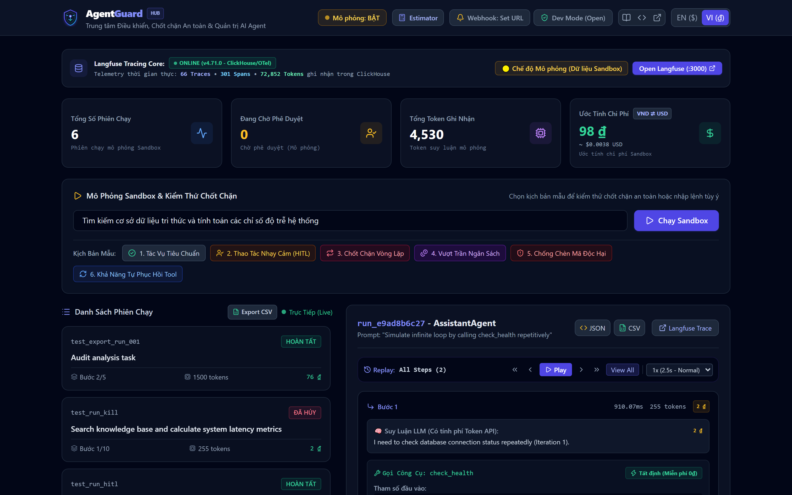
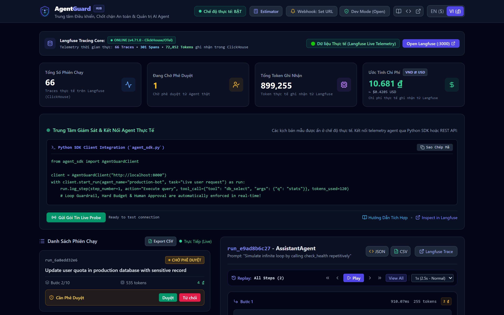
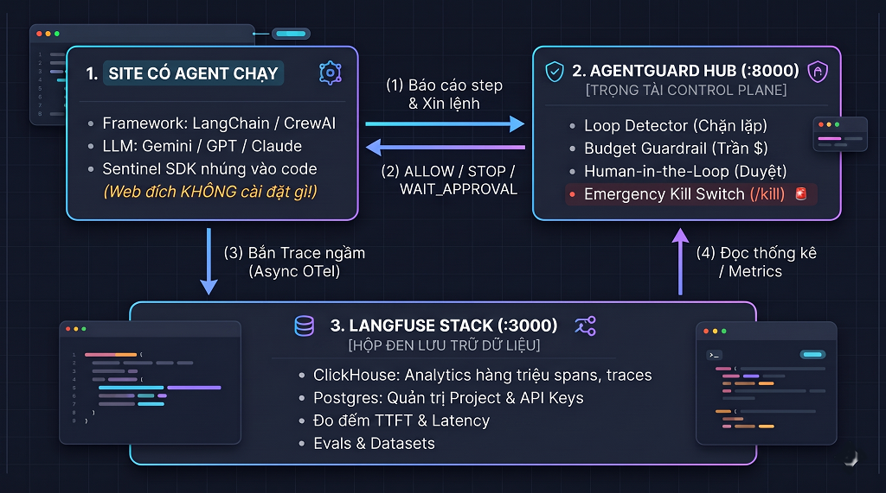

<div align="center">


### *Trung Tâm Điều Khiển, Chốt Chặn An Toàn & Quản Trị AI Agent*

[](https://github.com/longnguyen97-full/agent-management-system/actions)
[](https://www.python.org/)
[](https://fastapi.tiangolo.com)
[](https://langfuse.com)
[](https://github.com/astral-sh/uv)
[](LICENSE)

<p align="center">
  <a href="README.md">🇬🇧 English</a> •
  <a href="README.vi.md">🇻🇳 Tiếng Việt</a>
</p>

</div>

---

## 📸 Giao Diện & Hình Ảnh Minh Họa

<div align="center">
  
  <p><em>Trung tâm Giám sát & Điều khiển Thời gian thực AgentGuard (Giao diện Tiếng Việt kèm Tiền tệ VND ₫ và Nút Bật/Tắt Mô Phỏng)</em></p>
</div>

<br/>

<div align="center">
  <table width="100%">
    <tr>
      <td width="50%" align="center">
        
        <br/>
        <strong>🛡️ Phê duyệt của Con người (Human-in-the-Loop)</strong>
        <br/>
        <em>Tự động dừng Agent khi chuẩn bị sửa Database; chờ người quản trị bấm Authorize trên UI.</em>
      </td>
      <td width="50%" align="center">
        
        <br/>
        <strong>🛑 Chốt chặn Vòng lặp Vô tận (Loop Guardrail)</strong>
        <br/>
        <em>Phát hiện Agent lặp lại tool/tham số giống nhau và tự động ngắt tiến trình để bảo vệ ngân sách.</em>
      </td>
    </tr>
    <tr>
      <td width="50%" align="center">
        
        <br/>
        <strong>⚡ Dữ liệu Thực tế & Tracing ClickHouse</strong>
        <br/>
        <em>Traces, số lượng span và token thực tế được đồng bộ trực tiếp từ ClickHouse.</em>
      </td>
      <td width="50%" align="center">
        
        <br/>
        <strong>🌐 Chuyển Đổi Song Ngữ & Đồng Bộ Tiền Tệ Tự Động</strong>
        <br/>
        <em>1-click chuyển đổi linh hoạt giữa Tiếng Anh ($ USD) và Tiếng Việt (₫ VND) tức thì.</em>
      </td>
    </tr>
  </table>
</div>

---

## 🌟 Các Tính Năng & Năng Lực Cốt Lõi

**AgentGuard** là một nền tảng mã nguồn mở toàn diện phục vụ **Giám sát (Observability)** và **Điều khiển An toàn Vận hành (Control Plane & Guardrails)** cho các AI Agent tự hành:

1. **Điều Khiển Can Thiệp Thời Gian Thực (Active Control)**:
   - **Emergency Kill Switch**: Nút dừng khẩn cấp màu đỏ trên Dashboard hoặc API `POST /kill` giúp hủy tiến trình của Agent ngay tức thì.
   - **Loop Detector Guardrail**: Tự động nhận diện chữ ký tool call bị lặp lại và ngắt tiến trình trước khi Agent gây lãng phí tài khoản API.
   - **Budget Limiter**: Thiết lập trần cứng về số bước (steps), số lượng token và chi phí USD/VND cho mỗi phiên chạy.
2. **Nút Bật / Tắt Chế Độ Mô Phỏng (Simulation Mode Toggle)**:
   - Cho phép 1-click chuyển đổi linh hoạt giữa chế độ **Mô phỏng Sandbox** (chạy test thử nghiệm nhanh các chốt chặn mà không tốn phí API LLM thật) và **Chế độ Thực tế (Live Production Mode)**.
3. **Quy Trình Phê Duyệt Của Con Người (Human-in-the-Loop)**:
   - Tự động chuyển trạng thái sang `WAITING_APPROVAL` khi Agent cố tình gọi các công cụ nhạy cảm (như cập nhật cơ sở dữ liệu, gửi email, giao dịch tiền). Người giám sát có toàn quyền kiểm tra tham số và bấm **Authorize** hoặc **Reject**.
4. **Phân Định Chi Phí Chi Tiết (Billable vs Non-Billable)**:
   - Tách bạch rõ ràng giữa các bước suy luận LLM tốn phí token và các bước xử lý code tất định nội bộ (miễn phí 0đ / 0₫).
5. **Hỗ Trợ Song Ngữ & Song Tệ (USD & VND)**:
   - Giao diện có nút chuyển đổi tức thì giữa Tiếng Anh (USD) và Tiếng Việt (VND), tự động cập nhật toàn bộ bảng điều khiển và nhãn hiển thị.
6. **Lưu Trữ Phiên Bền Vững (Zero-Dependency SQLite Persistence)**:
   - Toàn bộ phiên chạy và các bước step được lưu tự động vào `data/agentguard.db`, dữ liệu tồn tại vĩnh viễn không bị mất khi restart server.
7. **Cảnh Báo Webhook Đa Kênh (Discord, Slack, n8n)**:
   - Giao diện có nút **Webhook Alerts** mở hộp thoại cấu hình và nút **Send Test Alert** gửi thử thông báo ngay lập tức.
8. **Bảo Mật API Key & Chế Độ Linh Hoạt (Security & RBAC)**:
   - Chế độ mở (Dev Mode) cho môi trường nội bộ và chế độ bắt buộc (`API_KEY`) cho môi trường sản xuất.
9. **Xuất Báo Cáo Kiểm Toán Audit (CSV & JSON)**:
   - Tải file kiểm toán chi tiết từng bước dạng JSON/CSV hoặc file tổng hợp tất cả các phiên chạy trong hệ thống.
10. **Bộ Tua Tư Duy (Time-Travel Step Replay)**:
    - Tua lại hành trình suy luận từng bước của Agent với các nút Play/Pause, điều chỉnh tốc độ (0.5x, 1x, 2x) và tự động cuộn (auto-scroll) làm nổi bật bước đang phát.
11. **Cổng Tiếp Nhận Chuẩn OpenTelemetry (OTLP Ingestion)**:
    - Endpoint `POST /v1/traces` tiếp nhận trực tiếp trace từ CrewAI, LangGraph, AutoGen mà không cần đổi kiến trúc code.
12. **Tự Động Sửa Lỗi Font & Giải Mã Tiếng Việt (Auto Text Sanitizer)**:
    - Tích hợp bộ tiền xử lý `ftfy` và chuẩn hóa Unicode (NFC) tự động khôi phục chuỗi văn bản bị lỗi font/mojibake từ client gửi lên.
13. **Trang Hướng Dẫn Sử Dụng Trực Quan (`/guide`) & Client SDK (`agent_sdk.py`)**:
    - Tài liệu hướng dẫn tích hợp chi tiết cùng thư viện client Python gọn nhẹ để nhúng vào dự án agent trong 3 dòng code.
14. **Dự Toán Chi Phí & ROI (ROI & Token Cost Estimator)**:
    - Công cụ mô phỏng ngân sách vận hành Agent theo quy mô thực tế (số phiên/ngày, số bước, số token), phân tích chi phí giữa các Model và tính toán số tiền tiết kiệm được nhờ Chốt Chặn Guardrails.
15. **Hệ Thống Biểu Giá Linh Hoạt & Đồng Bộ Tự Động (Dynamic Pricing Registry)**:
    - Chuẩn hóa biểu giá chính thức từ OpenAI, DeepMind, Anthropic, DeepSeek và vLLM Local; hỗ trợ nút 1-click **"Đồng Bộ Giá Mới"** kéo trực tiếp dữ liệu biểu giá mới nhất từ chỉ mục mở LiteLLM.
16. **Quản Lý Vòng Đời Dữ Liệu & Phục Hồi Thảm Họa (Backup / Restore / Reset)**:
    - Sao lưu toàn diện cả Dashboard SQLite và Langfuse Tracing (ClickHouse/PostgreSQL) thành các tệp nén `.zip` với 1-click trên Web UI hoặc lệnh CLI (`scripts/backup_manager.py`).
    - Cơ chế bảo vệ an toàn: tự động tạo bản lưu snapshot dự phòng trước khi phục hồi (restore) hoặc xóa (reset).

---

## 🏛️ Sơ đồ Kiến trúc Hệ thống

<div align="center">
  
</div>

```
                                 ┌──────────────────────────────────────────────┐
                                 │     AgentGuard Operator Dashboard Web UI     │
                                 │         http://localhost:8000/dashboard      │
                                 └──────────────┬───────────────────────────────┘
                                                │
                                    (SSE & REST API Call)
                                                ▼
  ┌─────────────────────────────────────────────────────────────────────────────┐
  │                 AgentGuard FastAPI Service (Control Plane)                  │
  │                                                                             │
  │  ┌───────────────────────┐   ┌──────────────────────┐   ┌─────────────────┐ │
  │  │ Loop Guardrail        │   │ Budget Guardrail     │   │ Human-in-the-   │ │
  │  │ (Chặn lặp vô tận)     │   │ (Chặn vượt token/$)  │   │ Loop Approval   │ │
  │  └───────────────────────┘   └──────────────────────┘   └─────────────────┘ │
  │                                                                             │
  │  ┌───────────────────────┐   ┌──────────────────────┐   ┌─────────────────┐ │
  │  │ Emergency Kill Switch │   │ Agent Run Registry   │   │ OpenInference   │ │
  │  │ (Dừng Agent khẩn cấp) │   │ (Quản lý tiến trình) │   │ Telemetry Span  │ │
  │  └───────────────────────┘   └──────────────────────┘   └────────┬────────┘ │
  └──────────────────────────────────────────────────────────────────┼──────────┘
                                                                     │
                                                   (OTel / Langfuse Ingestion)
                                                                     ▼
  ┌─────────────────────────────────────────────────────────────────────────────┐
  │                  Langfuse Tracing Stack (Docker Compose)                    │
  │                                                                             │
  │   - Langfuse Web UI (:3000)      - Langfuse Worker (:3030)                  │
  │   - PostgreSQL 17 (DB)           - ClickHouse (High-throughput analytics)   │
  │   - Redis (BullMQ queue)         - MinIO (Blob storage)                     │
  └─────────────────────────────────────────────────────────────────────────────┘
```

---

## ⚡ Hướng Dẫn Khởi Chạy Nhanh

### 1. Chuẩn bị môi trường
- Python >= 3.11
- Trình quản lý gói siêu tốc [`uv`](https://docs.astral.sh/uv/) (khuyên dùng)
- Docker & Docker Compose

### 2. Khởi chạy Cụm Hạ Tầng Langfuse Observability
Khởi động cụm dịch vụ tracing (Postgres, ClickHouse, Redis, MinIO, Langfuse UI & Worker):
```bash
docker compose up -d
```
> Giao diện Langfuse Web sẽ khả dụng tại: **[http://localhost:3000](http://localhost:3000)**  
> *Tài khoản mặc định:* `admin@example.com` / `AdminPassword123!`

### 3. Khởi chạy Custom Agent Management Backend & Dashboard
```bash
# Cài đặt và đồng bộ thư viện
uv sync --all-groups

# Khởi chạy hệ thống AgentGuard
uv run run.py
# hoặc dùng lệnh rút gọn:
uv run agent-hub
```

Ứng dụng sẽ hoạt động trên:
- 📊 **AgentGuard Dashboard:** [http://localhost:8000/dashboard](http://localhost:8000/dashboard)
- 📖 **Tài Liệu Hướng Dẫn:** [http://localhost:8000/guide](http://localhost:8000/guide)
- 📖 **Swagger API Docs:** [http://localhost:8000/docs](http://localhost:8000/docs)
- 🔍 **Health Check:** [http://localhost:8000/health](http://localhost:8000/health)

---


## 🧪 Các Kịch Bản Kiểm Thử Có Sẵn (Demo Scenarios)

Truy cập Dashboard tại `http://localhost:8000/dashboard`, bạn có thể bấm thử ngay 4 kịch bản mẫu:

| Kịch bản | Thao tác | Hiện tượng quan sát |
| :--- | :--- | :--- |
| **1. Luồng chuẩn 3 bước** | Agent suy luận + gọi công cụ tính toán. | Token và chi phí USD/VND tăng dần theo thời gian thực; timeline từng bước rõ ràng. |
| **2. Tác vụ nhạy cảm (HITL)** | Agent gọi `execute_database_update`. | Agent tự động tạm dừng ở trạng thái `WAITING_APPROVAL`. Người quản trị bấm **Authorize** hoặc **Reject**. |
| **3. Chặn vòng lặp (Loop Detector)** | Agent liên tục lặp lại tool cùng tham số. | Bộ lọc can thiệp sau 2 lần lặp, ngắt tiến trình an toàn để bảo vệ tài khoản API. |
| **4. Dừng khẩn cấp (Kill Switch)** | Bấm nút Kill Switch màu đỏ trên Dashboard. | Trạng thái chuyển ngay sang `KILLED` và tiến trình lập tức bị hủy bỏ. |

---

## 🔌 Tích Hợp Agent Bên Ngoài Vào AgentGuard Hub

AgentGuard cho phép kết nối **bất kỳ hệ thống Agent độc lập nào** (Python, Node.js, Next.js, Go) vào Trung tâm Điều khiển qua AI Skill tự động, Python SDK hoặc TypeScript client.

### 🤖 Phương Án 0: Tích Hợp Tự Động 1 Chạm Bằng Trợ Lý AI (Khuyến Nghị Tuyệt Đối)

Người dùng không cần phải tự sửa code thủ công! Nếu bạn sử dụng trợ lý lập trình AI (**Google Antigravity**, **Cursor**, **Claude Code**, **GitHub Copilot**, **Windsurf**), dự án cung cấp sẵn một **AI Skill chuẩn hóa** tại [`skills/embed-agentguard/SKILL.md`](skills/embed-agentguard/SKILL.md).

Chỉ cần nhập một câu lệnh vào cửa sổ chat với AI:
```markdown
"Hãy dùng skill embed-agentguard để nhúng chốt chặn giám sát AgentGuard vào bot này (kết nối http://localhost:8000)"
```

Trợ lý AI sẽ tự động:
1. Quét mã nguồn để xác định ngôn ngữ (Python hay TypeScript/Node.js) và framework (LangChain, CrewAI, AutoGen, v.v.).
2. Tự chép bộ Sentinel SDK (`agent_sdk.py` hoặc `agentHubClient.ts`) vào thư mục thích hợp.
3. Thêm cấu hình `AGENT_HUB_URL=http://localhost:8000` vào file `.env`.
4. Bọc các bước chạy của bot vào `start_run()`, `log_step()`, `finish()` theo cơ chế an toàn **fail-open** (nếu Hub tắt thì bot vẫn chạy bình thường).
5. Tách biệt công cụ nội bộ 0₫ vs lượt gọi LLM có phí.
6. Gửi ping kiểm tra `/health` và cung cấp link Dashboard `:8000` để xem kết quả ngay.

---

### 🐍 Phương Án A: Tích Hợp Thủ Công Bằng Python SDK (`agent_sdk.py`)

Bạn có thể kết nối bất kỳ Agent nào (LangChain, CrewAI, AutoGen hay Python thuần) vào hệ thống bằng [`agent_sdk.py`](agent_sdk.py):

```python
from agent_sdk import AgentTracker

# 1. Khởi tạo tracker kết nối tới Hub
tracker = AgentTracker(endpoint="http://localhost:8000")

# 2. Đăng ký phiên chạy mới
session = tracker.start_run(
    agent_name="OrderSupportAgent",
    prompt="Hỗ trợ tra cứu đơn hàng #DH-9921 và tạo mã giảm giá",
    budget_usd=0.25
)

# 3. Ghi nhận bước suy luận / gọi tool LLM (tốn phí token)
session.log_step(
    thought="Khách hàng yêu cầu kiểm tra đơn hàng. Cần truy vấn database đơn hàng.",
    tool_name="order_database_query",
    tool_input={"order_id": "DH-9921"},
    tool_output={"status": "DELIVERED"},
    tokens_used=240,
    cost_usd=0.00008,
    is_billable=True
)

# 4. Ghi nhận bước xử lý nội bộ miễn phí (0₫ / $0.00)
session.log_step(
    thought="Đơn hàng hợp lệ. Sinh mã giảm giá cảm ơn khách hàng.",
    tool_name="generate_promo_coupon",
    tool_input={"discount_percent": 10},
    tool_output={"code": "THANKYOU10"},
    tokens_used=0,
    cost_usd=0.0,
    is_billable=False
)

# 5. Hoàn tất tác vụ
session.finish(final_output="Đã hoàn thành! Mã giảm giá THANKYOU10 đã được gửi.")
```

> Chạy kiểm thử tự động toàn diện trên cả 3 hệ thống vệ tinh:
> ```bash
> uv run python mock-systems/run_all.py --test
> ```

---

## 🛰️ Kiểm Thử Thực Tế Với Hệ Thống Vệ Tinh (Mock Systems) & Hướng Dẫn Đọc Chỉ Số

Thay vì chỉ chạy các script mô phỏng cục bộ, AgentGuard cung cấp sẵn **3 hệ thống vệ tinh độc lập** đại diện cho các tech stack doanh nghiệp thực tế (FastAPI, Node.js, Python Worker):

| Hệ Thống Vệ Tinh | Cổng & Stack | Vai Trò AI Agent | Chốt Chặn & Tính Năng Kiểm Thử | Hành Vi Mong Đợi |
| :--- | :--- | :--- | :--- | :--- |
| **1. E-Commerce Service** | `:8010` (FastAPI) | `CustomerCareBot`: Tra cứu đơn hàng, kiểm tra kho, sinh mã giảm giá | 🟢 **Phân tách chi phí** ($0.00 vs LLM có phí) | Tách bạch bước suy luận LLM (tính tiền token API) vs công cụ nội bộ (0₫). Trạng thái: `HOÀN TẤT`. |
| **2. FinTech Transfer** | `:8020` (Node.js) | `BankTransferAgent`: Chuyển tiền tự động | ⏸️ **Human-in-the-Loop** (`WAITING_APPROVAL`) | Tự động tạm dừng khi phát hiện giao dịch nhạy cảm. Quản trị viên duyệt/từ chối trực tiếp trên Dashboard. |
| **3. Autonomous Crawler** | `:8030` (Python Worker) | `MarketCrawlerWorker`: Cào báo cáo thị trường | 🛡️ **Loop Detector** & 💰 **Budget Limiter** | Thuật toán băm SHA-256 đối số chặn đứng vòng lặp sau 2 lần lặp. Trạng thái: `LOOP_DETECTED`. |

### 🚀 Điều Phối 1 Lệnh Duy Nhất

```bash
# Cách 1: Tự động chạy kiểm thử E2E cả 3 hệ thống và tự dọn dẹp
uv run python mock-systems/run_all.py --test

# Cách 2: Khởi chạy dạng daemon giữ sống cả 3 cổng :8010, :8020, :8030 để test bằng cURL / Postman
uv run python mock-systems/run_all.py --daemon
```

### 📊 Hướng Dẫn Đọc Các Chỉ Số Trên Dashboard & Langfuse

Khi chuyển sang **Chế độ Trực Tiếp (Live Mode)** trên Dashboard (`http://localhost:8000/dashboard`):

1. **Tổng Số Phiên Chạy**: Tổng số phiên agent thực gửi về từ các dịch vụ vệ tinh.
2. **Đang Chờ Phê Duyệt**: Số phiên bị chốt chặn tạm dừng ở trạng thái `WAITING_APPROVAL` (ví dụ từ `:8020`). Bấm **Duyệt** để cho phép chạy tiếp hoặc **Từ chối** để hủy.
3. **Tổng Token Ghi Nhận**: Tổng số token suy luận có tính phí API. Các bước chạy công cụ nội bộ (ví dụ truy vấn DB) tiêu thụ `0 tokens`.
4. **Ước Tính Chi Phí**: Chi phí quy đổi theo thời gian thực (hỗ trợ chuyển đổi **VND ₫** và **USD $** trên thanh menu).
5. **Thanh Soi Hành Trình ReAct (Inspector)**: Bấm vào phiên bất kỳ để xem lại từng bước suy luận, câu lệnh, tham số gọi tool, thời gian trễ (ms) và thẻ chi phí.
6. **Truy Vết Sâu Langfuse (:3000)**: Bấm nút **Open Langfuse** để xem biểu đồ OTel waterfall spans, phân bổ token và đồ thị trễ ClickHouse.

> 📖 **Xem tài liệu chi tiết**: [`docs/MOCK_SYSTEMS_GUIDE.md`](docs/MOCK_SYSTEMS_GUIDE.md) và cẩm nang tương tác trực tiếp tại [http://localhost:8000/guide](http://localhost:8000/guide).

---

## 🧪 Chạy Kiểm Thử Tự Động (Automated Test Suite)

Dự án đi kèm bộ test toàn diện kiểm tra 100% các chốt chặn an toàn:
```bash
uv run pytest -v
```

Kết quả:
```text
tests/test_agent_system.py::test_standard_agent_execution PASSED         [ 16%]
tests/test_agent_system.py::test_loop_detector_guardrail PASSED          [ 33%]
tests/test_agent_system.py::test_budget_limit_guardrail PASSED           [ 50%]
tests/test_agent_system.py::test_human_in_the_loop_approval PASSED       [ 66%]
tests/test_agent_system.py::test_emergency_kill_switch PASSED            [ 83%]
tests/test_external_api.py::test_external_agent_ingestion_lifecycle PASSED [100%]
============================== 6 passed in 19s ===============================
```

---

## 📂 Cấu Trúc Thư Mục Dự Án

```text
agent-management-system/
├── assets/                  # Site logo (SVG, PNG), mã QR & ảnh chụp màn hình UI
├── docker-compose.yml       # Cụm hạ tầng Langfuse (Web, Worker, Postgres, Redis, ClickHouse, MinIO)
├── .env.example             # Mẫu biến môi trường an toàn
├── pyproject.toml           # Cấu hình dự án và dependencies
├── run.py                   # Script khởi chạy nhanh backend (an toàn UTF-8 trên Windows)
├── Dockerfile               # Đóng gói backend container
├── agent_sdk.py             # Client SDK siêu nhẹ để nhúng vào Agent bên ngoài
├── backend/
│   └── app/
│       ├── main.py          # Khởi tạo FastAPI & mount router & static assets
│       ├── config.py        # Quản lý cấu hình Pydantic Settings
│       ├── core/
│       │   ├── tracer.py        # Wrapper tích hợp Langfuse v5 (OpenInference / OTel)
│       │   ├── guardrails.py    # Bộ quy tắc: Loop detection, Budget limits, Approval check
│       │   ├── registry.py      # Quản lý trạng thái Agent, Kill Switch & SSE broadcasting
│       │   ├── alerts.py        # Cảnh báo webhook đa kênh (Discord, Slack, n8n)
│       │   ├── auth.py          # Xác thực Operator API Key bảo mật
│       │   ├── db.py            # Lưu trữ phiên & step bền vững SQLite
│       │   ├── export.py        # Tiện ích xuất báo cáo kiểm toán (CSV / JSON)
│       │   ├── otlp.py          # Tiếp nhận trace chuẩn OpenTelemetry OTLP
│       │   ├── pricing.py       # Biểu giá LLM động & đồng bộ token economics
│       │   ├── sanitizer.py     # Tự động sửa lỗi font tiếng Việt & Unicode
│       │   └── backup.py        # Động cơ Sao lưu, Phục hồi & Đặt lại dữ liệu
│       ├── agents/
│       │   ├── base.py          # Abstract BaseAgent định nghĩa vòng đời quan sát
│       │   └── sample_agent.py  # Agent mẫu thông minh hỗ trợ các kịch bản ReAct
│       ├── api/
│       │   └── routes.py        # REST API endpoints & Server-Sent Events (SSE)
│       ├── schemas/
│       │   └── agent.py         # Pydantic data schemas
│       └── templates/
│           ├── dashboard.html   # Giao diện giám sát & điều khiển thời gian thực (Đa ngôn ngữ & Song tệ)
│           └── guide.html       # Trang tài liệu hướng dẫn sử dụng & cẩm nang tích hợp
├── scripts/
│   ├── generate_screenshots.py # Script tự động chụp màn hình UI bằng Playwright (EN/VI)
│   └── backup_manager.py       # Công cụ dòng lệnh quản lý dữ liệu, sao lưu & reset
├── docs/
│   ├── CLIENT_INTEGRATION_GUIDE.md    # Hướng dẫn chi tiết nhúng SDK & API (Tiếng Anh)
│   ├── CLIENT_INTEGRATION_GUIDE.vi.md # Hướng dẫn chi tiết nhúng SDK & API (Tiếng Việt)
│   ├── MOCK_SYSTEMS_GUIDE.md          # Hướng dẫn test mock-systems & đọc chỉ số (Tiếng Anh)
│   └── MOCK_SYSTEMS_GUIDE.vi.md       # Hướng dẫn test mock-systems & đọc chỉ số (Tiếng Việt)
└── tests/                       # Toàn bộ test suite tự động (20 unit & integration tests)
```

---

## 💬 Cộng Đồng & Đóng Góp Ý Kiến

Chúng tôi rất hoan nghênh những phản hồi, ý tưởng và đóng góp từ cộng đồng:
- **⭐ Tặng 1 Sao Trên GitHub**: Nếu bạn thấy AgentGuard hữu ích, hãy tặng dự án một ngôi sao trên [GitHub](https://github.com/longnguyen97-full/agent-management-system/) nhé!
- **Báo Cáo Lỗi & Đề Xuất**: Mở issue hoặc thảo luận tại [GitHub Issues](https://github.com/longnguyen97-full/agent-management-system/issues).

---

## 💖 Ủng Hộ & Tài Trợ Dự Án (Donate)

Nếu bạn thấy **AgentGuard** hữu ích và muốn tiếp sức cho việc phát triển mã nguồn mở miễn phí lâu dài, hãy mời tác giả một ly cà phê nhé! ☕

<div align="center">
  
  <br/>
  <em>Quét mã QR qua ứng dụng Ngân hàng / Mobile Banking / VietQR</em>
  <br/>
  <strong>Chân thành cảm ơn sự đồng hành và ủng hộ của bạn! ❤️</strong>
</div>

---

## 🤝 Đóng Góp Phát Triển

Dự án luôn mở rộng chào đón đóng góp từ cộng đồng! Vui lòng đọc kỹ [CONTRIBUTING.md](CONTRIBUTING.md) và [CODE_OF_CONDUCT.md](CODE_OF_CONDUCT.md).

---

## 📄 Giấy Phép (License)

Dự án được phát hành theo giấy phép mã nguồn mở [MIT License](LICENSE) — hoàn toàn miễn phí cho mục đích học tập, nghiên cứu và thương mại.
