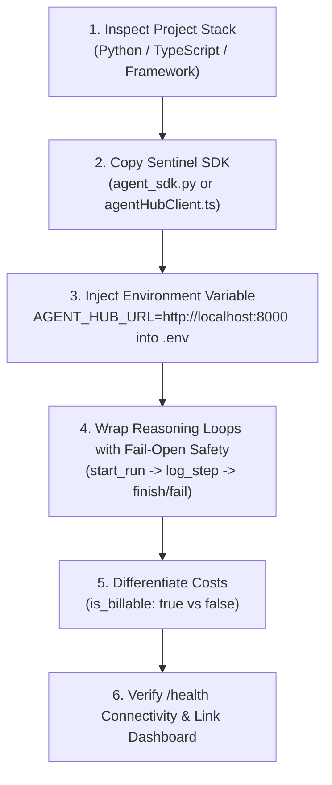

# AGENTGUARD CLIENT INTEGRATION & OPERATIONAL MANUAL
> **Language / Ngôn ngữ**: [English](CLIENT_INTEGRATION_GUIDE.md) • [Tiếng Việt](CLIENT_INTEGRATION_GUIDE.vi.md)  
> **Audience**: AI Engineers, Software Architects, and Full-Stack Developers integrating autonomous AI Agents (Python, Node.js, Next.js, Go) into the AgentGuard Control Plane.

---

## 1. Overview & Two-Tier Architecture

<div align="center">
  
</div>

AgentGuard couples two independent, complementary observability layers:

```
┌─────────────────────────────────────────────────────────────────────────────┐
│                       EXTERNAL APPLICATION (CLIENT RUNTIME)                 │
│      (e.g., Content Moderator, Customer Care Agent, Financial Bot)          │
└──────────────────────┬───────────────────────────────┬──────────────────────┘
                       │ (1) OpenInference / OTel      │ (2) Live Session Ingestion
                       │ Telemetry & Spans             │ (Lifecycle & Control Plane)
                       ▼                               ▼
       ┌───────────────────────────────┐ ┌───────────────────────────────────┐
       │     LANGFUSE OBSERVABILITY    │ │      AGENTGUARD CONTROL HUB       │
       │           (:3000)             │ │              (:8000)              │
       │ - Detailed Tracing Tree       │ │ - Live Agent Sessions Dashboard   │
       │ - Token & Latency Histograms  │ │ - Emergency Kill Switch           │
       │ - ClickHouse / PG Store       │ │ - Loop & Budget Guardrails        │
       │ - Evals & Datasets            │ │ - Human-in-the-Loop (HITL) Queue  │
       └───────────────┬───────────────┘ └─────────────────┬─────────────────┘
                       │                                   │
                       └───────────────►◄──────────────────┘
                            (ClickHouse Query Telemetry)
```

### ⚠️ Important Distinction: "Live Agent Sessions" vs "Langfuse Traces":
- **Langfuse (:3000)**: Operates as the **Flight Data Recorder**. Stores historical OTel **Traces**, **Spans** (0đ / $0.00 local steps), and **Generations** (billable LLM tokens).
- **AgentGuard Control Hub (:8000/dashboard)**: Operates as the **Air Traffic Controller**.
  - In **Simulation Mode**: Runs preset benchmark test scenarios.
  - In **Live Mode**: Ingests real-time **Live Agent Sessions** registered via the Hub API (`/api/agents/external/...`). If an external bot only sends raw traces without calling the Hub lifecycle API, the dashboard provides a direct counter linking to your ClickHouse data.

---

## 2. Option 0 (Recommended): 1-Click Automated AI Assistant Embedding

> **Target**: Developers using AI coding assistants like **Google Antigravity**, **Cursor**, **Claude Code**, **GitHub Copilot**, or **Windsurf**.  
> **Advantage**: You do **not** need to manually copy code or edit files. Your AI assistant reads our standardized skill and instruments your agent safely with fail-open guarantees.

### 🌟 Standardized AI Assistant Skill: `skills/embed-agentguard/SKILL.md`

AgentGuard includes an official agentic coding skill:  
👉 [`skills/embed-agentguard/SKILL.md`](../skills/embed-agentguard/SKILL.md)

### 🚀 Activation Prompts

Open your coding assistant chat window and paste:

#### English:
```text
Read skills/embed-agentguard/SKILL.md and embed AgentGuard monitoring, safety guardrails, and telemetry into this AI agent project (connecting to Hub at http://localhost:8000). Ensure zero-downtime fail-open safety.
```

#### Tiếng Việt:
```text
Hãy đọc file skills/embed-agentguard/SKILL.md và tự động nhúng toàn bộ chốt chặn giám sát AgentGuard vào project agent này (kết nối về Hub tại http://localhost:8000). Đảm bảo giữ nguyên logic hiện tại và áp dụng cơ chế an toàn fail-open.
```

### ⚙️ 6-Step Automated Workflow:



---

## 3. Option 1: Manual Integration for Node.js / TypeScript / Next.js

### Step 1: Create Helper Client (`agentHubClient.ts`)

Create `src/lib/agentHubClient.ts` (or `utils/agentHubClient.ts`):

```typescript
const HUB_URL = process.env.AGENT_HUB_URL || 'http://localhost:8000';
const API_KEY = process.env.AGENT_HUB_API_KEY || '';

interface StartRunParams {
  agent_name: string;
  prompt: string;
  max_steps?: number;
  budget_usd?: number;
  require_approval_tools?: string[];
}

interface LogStepParams {
  thought?: string;
  tool_name?: string;
  tool_input?: Record<string, any>;
  tool_output?: Record<string, any>;
  tokens_used?: number;
  cost_usd?: number;
  is_billable?: boolean;
}

export class AgentHubClient {
  private runId: string | null = null;

  async startRun(params: StartRunParams): Promise<string | null> {
    try {
      const res = await fetch(`${HUB_URL}/api/agents/external/start`, {
        method: 'POST',
        headers: {
          'Content-Type': 'application/json',
          ...(API_KEY ? { 'X-API-Key': API_KEY } : {}),
        },
        body: JSON.stringify(params),
      });
      if (!res.ok) return null;
      const data = await res.json();
      this.runId = data.run_id;
      return this.runId;
    } catch {
      return null; // Fail-open guarantee: agent never crashes if Hub is offline
    }
  }

  async logStep(params: LogStepParams): Promise<boolean> {
    if (!this.runId) return false;
    try {
      const res = await fetch(`${HUB_URL}/api/agents/external/${this.runId}/step`, {
        method: 'POST',
        headers: {
          'Content-Type': 'application/json',
          ...(API_KEY ? { 'X-API-Key': API_KEY } : {}),
        },
        body: JSON.stringify({
          thought: params.thought || '',
          tool_name: params.tool_name || '',
          tool_input: params.tool_input || {},
          tool_output: params.tool_output || {},
          tokens_used: params.tokens_used || 0,
          cost_usd: params.cost_usd || 0.0,
          is_billable: params.is_billable ?? true,
        }),
      });
      return res.ok;
    } catch {
      return false;
    }
  }

  async finish(finalOutput: string): Promise<boolean> {
    if (!this.runId) return false;
    try {
      const res = await fetch(`${HUB_URL}/api/agents/external/${this.runId}/finish`, {
        method: 'POST',
        headers: {
          'Content-Type': 'application/json',
          ...(API_KEY ? { 'X-API-Key': API_KEY } : {}),
        },
        body: JSON.stringify({ final_output: finalOutput, status: 'COMPLETED' }),
      });
      return res.ok;
    } catch {
      return false;
    }
  }

  async fail(errorMsg: string): Promise<boolean> {
    if (!this.runId) return false;
    try {
      const res = await fetch(`${HUB_URL}/api/agents/external/${this.runId}/finish`, {
        method: 'POST',
        headers: {
          'Content-Type': 'application/json',
          ...(API_KEY ? { 'X-API-Key': API_KEY } : {}),
        },
        body: JSON.stringify({ final_output: errorMsg, status: 'FAILED' }),
      });
      return res.ok;
    } catch {
      return false;
    }
  }
}
```

### Step 2: Use in Next.js API Route / Server Action

```typescript
import { AgentHubClient } from '@/lib/agentHubClient';

export async function POST(req: Request) {
  const { prompt } = await req.json();
  const hub = new AgentHubClient();

  // 1. Register run session
  await hub.startRun({
    agent_name: 'Content_Moderation_Agent',
    prompt,
    max_steps: 5,
    budget_usd: 0.10,
    require_approval_tools: ['delete_user_post', 'ban_account'],
  });

  try {
    // 2. Log billable LLM thought
    await hub.logStep({
      thought: 'Analyzing user content against community guidelines.',
      tool_name: 'policy_classifier',
      tokens_used: 180,
      cost_usd: 0.00005,
      is_billable: true,
    });

    // 3. Log free local deterministic action
    await hub.logStep({
      thought: 'Applying local regex keyword filter.',
      tool_name: 'regex_keyword_check',
      tokens_used: 0,
      cost_usd: 0.0,
      is_billable: false,
    });

    // 4. Conclude session
    await hub.finish('Analysis complete: content complies with guidelines.');
    return Response.json({ success: true });
  } catch (err: any) {
    await hub.fail(err.message);
    return Response.json({ error: err.message }, { status: 500 });
  }
}
```

---

## 4. Option 2: Manual Integration for Python (`agent_sdk.py`)

Copy [`agent_sdk.py`](../agent_sdk.py) directly into your agent repository:

```python
import os
os.environ["PYTHONUTF8"] = "1"  # Prevent Windows cp1252 mojibake

from agent_sdk import AgentTracker

# 1. Initialize tracker pointing to Hub
tracker = AgentTracker(endpoint="http://localhost:8000")

# 2. Start a run session
session = tracker.start_run(
    agent_name="CustomerSupportAgent",
    prompt="Check status for order #DH-9921 and issue discount coupon",
    budget_usd=0.25,
    require_approval_tools=["issue_refund", "execute_database_update"]
)

# 3. Log billable LLM reasoning step
session.log_step(
    thought="Querying internal order database to inspect delivery logs.",
    tool_name="order_database_query",
    tool_input={"order_id": "DH-9921"},
    tool_output={"status": "DELIVERED"},
    tokens_used=240,
    cost_usd=0.00008,
    is_billable=True
)

# 4. Log deterministic local step (Free / $0.00 / 0 tokens)
session.log_step(
    thought="Order confirmed delivered. Generating loyalty discount coupon locally.",
    tool_name="generate_promo_coupon",
    tool_input={"discount_percent": 10},
    tool_output={"code": "LOYALTY10"},
    tokens_used=0,
    cost_usd=0.0,
    is_billable=False
)

# 5. Finish session
session.finish(final_output="Order delivered! Discount coupon LOYALTY10 generated.")
```

---

## 5. Detailed REST API Endpoints for External Agents

If you are using Go, Rust, Java, or raw HTTP clients, use the following endpoints:

### `POST /api/agents/external/start`
Registers a new session in the Hub registry.
```bash
curl -X POST http://localhost:8000/api/agents/external/start \
  -H "Content-Type: application/json" \
  -d '{
    "agent_name": "FinanceAuditor",
    "prompt": "Audit Q3 expenses",
    "max_steps": 5,
    "budget_usd": 0.50,
    "require_approval_tools": ["execute_bank_transfer"]
  }'
```
Response: `{"run_id": "run_9d22a63ad1", "status": "RUNNING"}`

### `POST /api/agents/external/{run_id}/step`
Streams an intermediate reasoning thought or tool execution step.
```bash
curl -X POST http://localhost:8000/api/agents/external/run_9d22a63ad1/step \
  -H "Content-Type: application/json" \
  -d '{
    "thought": "Checking ledger balances",
    "tool_name": "query_ledger",
    "tool_input": {"quarter": "Q3"},
    "tool_output": {"discrepancies": 0},
    "tokens_used": 150,
    "cost_usd": 0.00004,
    "is_billable": true
  }'
```

### `POST /api/agents/external/{run_id}/finish`
Concludes a run session with a final status.
```bash
curl -X POST http://localhost:8000/api/agents/external/run_9d22a63ad1/finish \
  -H "Content-Type: application/json" \
  -d '{
    "final_output": "Audit complete. Zero discrepancies found.",
    "status": "COMPLETED"
  }'
```

---

## 6. Financial Separation: Billable LLM ($) vs Deterministic Free ($0.00)

| Step Type | `is_billable` | `tokens_used` | `cost_usd` | Financial Effect on Dashboard |
| :--- | :--- | :--- | :--- | :--- |
| **OpenAI / Gemini / Claude Call** | `True` | `> 0` | Model calculation | Added to Total Tokens & Estimated Spend. |
| **Local DB Query (SQLite / Postgres)** | `False` | `0` | `0.0` | Marked **Deterministic (Free / $0.00)**. |
| **Regex / Local Regex Token Filter** | `False` | `0` | `0.0` | Marked **Deterministic (Free / $0.00)**. |
| **API Cache Hit** | `False` | `0` | `0.0` | Marked **Deterministic (Free / $0.00)**. |

---

## 7. Crucial Notes & Troubleshooting

### 💡 Note 1: Windows UTF-8 Handling (Prevent `?` and Mojibake)
Windows PowerShell defaults to `cp1252`, corrupting non-ASCII characters into `?` (ASCII 63).  
In Python:
```python
import os, sys
os.environ["PYTHONUTF8"] = "1"
```
In PowerShell:
```powershell
[Console]::OutputEncoding = [System.Text.Encoding]::UTF8
chcp 65001
```

### 💡 Note 2: Avoid `ModuleNotFoundError: No module named 'fastapi'`
Always launch the Hub with `uv run run.py` (or `uv run agent-hub`) rather than bare system python.

### 💡 Note 3: Human-in-the-Loop (HITL) Workflow
Declare sensitive tools in `require_approval_tools: ["transfer_funds", "mutate_database"]`. When called, the Hub intercepts the tool call, locks the session in `WAITING_APPROVAL`, and notifies operators via Dashboard and Webhooks.

### 💡 Note 4: Standard OpenTelemetry (OTLP) Ingestion
For frameworks with native OTel support (CrewAI, LangGraph, AutoGen):
```bash
export OTEL_EXPORTER_OTLP_ENDPOINT="http://localhost:8000/v1/traces"
export OTEL_EXPORTER_OTLP_PROTOCOL="http/json"
```

### 💡 Note 5: Satellite Mock Systems Live Verification
AgentGuard includes 3 standalone satellite services in `mock-systems/` (:8010, :8020, :8030). Run a complete live test with 1 command:
```bash
uv run python mock-systems/run_all.py --test
```
> See [`docs/MOCK_SYSTEMS_GUIDE.md`](MOCK_SYSTEMS_GUIDE.md) for full instructions and metric interpretation.

---

## 💖 8. Community, Feedback & Sponsorship (Donate)

We welcome your feedback, questions, and contributions:
- **⭐ Star on GitHub**: [GitHub Repository](https://github.com/longnguyen97-full/agentguard-hub-management-system/)
- **💬 Bug Reports & Guardrail Proposals**: [GitHub Issues](https://github.com/longnguyen97-full/agentguard-hub-management-system/issues)

### ☕ Support the Author (Buy Me a Coffee)
If you find **AgentGuard** valuable for securing your AI agents, consider supporting our ongoing open-source work:

<div align="center">
  
  <br/>
  <em>Scan via Mobile Banking / VietQR to support this project</em>
  <br/>
  <strong>Thank you for empowering open-source AI safety! ❤️</strong>
</div>
